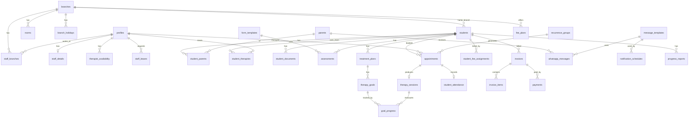

# XenoCare / vSchool — Database

Supabase (PostgreSQL 15+). One organization with multiple branches.
Logins: **owner**, **admin**, **therapist**. Parents have no login. They are contacted through the WhatsApp API.

## Setup

```bash
supabase init            # creates supabase/config.toml (keeps existing migrations)
supabase start
supabase db reset        # applies migrations + seed.sql
supabase test db         # runs supabase/tests/database/*.test.sql
supabase gen types typescript --local > shared/database.types.ts
```

Deploy: `supabase link --project-ref <ref>` then `supabase db push`.
In the dashboard, under **Auth → Providers → Email**, **disable public sign-ups**. Express creates every user.

### Creating users (Express, service role)

```js
await supabaseAdmin.auth.admin.createUser({
  email, password, email_confirm: true,
  user_metadata: { full_name },
  app_metadata:  { role: 'owner' | 'admin' | 'therapist' },   // server-only, cannot be forged
});
// then insert staff_branches rows (and staff_details)
```

The `on_auth_user_created` trigger creates the `profiles` row. Users can edit only `full_name`, `phone` and `avatar_url` on their own profile. Role and `is_active` changes go through Express.

## Who can do what (RLS)

| Area | Owner | Admin (own branches) | Therapist |
|---|---|---|---|
| Branches, settings, staff↔branch | full | read | read |
| Staff details, availability, leave | full | branch staff | own |
| Students, parents | full | home branch + treated in branch | assigned students (read) |
| Assessments, plans, goals, sessions, reports | full | branch | own + assigned students |
| Appointments | full | branch | own (can update status) |
| Attendance | full | branch | own appointments |
| Fee plans, invoices, payments | full | branch | **none** |
| WhatsApp log | full | branch (can queue) | none |
| Audit log | full | branch (read) | none |

Signed (`is_locked`) session notes can only be changed by the owner.
Fine-grained UI permissions: `supabase.rpc('my_permissions')` returns permission keys (role defaults plus per-user overrides).

## Data-access split

- **React + Supabase client (RLS):** lists, detail pages, calendar, notes, dashboards (views).
- **Express (service role):** creating users, expanding recurring appointments, sending WhatsApp (reads `whatsapp_messages` where `status='queued'`, plus the delivery webhook), reminder cron (`notification_schedules`), PDF reports, un-voiding invoices (`select public.refresh_invoice(id)`).

## Automatic behaviour (triggers)

| What | Where |
|---|---|
| `updated_at` maintained | every table with the column |
| `students.student_code` = `STU000001` | sequence default |
| `invoices.invoice_no` = `GDV-2026-00001` | per branch, per year |
| `invoices.subtotal / amount_paid / status` | recalculated from `invoice_items` and `payments` |
| `payments.branch_id / student_id` | copied from the invoice |
| No double booking (therapist, student, room) | exclusion constraints on `appointments` |
| Audit log | students, parents, staff, clinical, appointments, billing |

## Dashboard views (respect RLS)

`v_branch_revenue_monthly` · `v_branch_dues_summary` · `v_outstanding_dues` (includes the primary parent's WhatsApp number) · `v_therapist_utilization` · `v_attendance_summary` · `v_students_by_branch`

## Storage (private buckets, use signed URLs)

| Bucket | Path | Access |
|---|---|---|
| `student-documents` | `{student_id}/...` | same as the student |
| `reports` | `{student_id}/...` | same as the student |
| `avatars` | `{profile_id}/...` | everyone reads; owner of the folder writes |

## ERD



## Backup & security checklist

- [ ] Supabase Pro: daily backups, or turn on PITR for patient data.
- [ ] A nightly GitHub Action runs `supabase db dump` to off-site storage (encrypted).
- [ ] The service role key lives only in the Express env, never in React.
- [ ] WhatsApp access token lives in the Express env (not in `organization_settings`).
- [ ] Public sign-ups are disabled. Turn on MFA for owner and admins.
- [ ] Run the Supabase **Advisors** (security and performance) after every migration.
- [ ] A new table needs its own `enable row level security`, policies, and `set_updated_at` trigger.
